

<picture><source media="(prefers-color-scheme: light)" srcset="assets/header-light.svg" /><source media="(prefers-color-scheme: dark)" srcset="assets/header.svg" /></picture>

<picture><source media="(prefers-color-scheme: light)" srcset="assets/typing-light.svg" /><source media="(prefers-color-scheme: dark)" srcset="assets/typing.svg" /></picture>

 

 

<picture><source media="(prefers-color-scheme: light)" srcset="assets/about-light.svg" /><source media="(prefers-color-scheme: dark)" srcset="assets/about.svg" /></picture>

 

<picture><source media="(prefers-color-scheme: light)" srcset="assets/workflow-light.svg" /><source media="(prefers-color-scheme: dark)" srcset="assets/workflow.svg" /></picture>

## 🚀 Featured · open source

<a href="https://alpha-board-app.vercel.app"><picture><source media="(prefers-color-scheme: light)" srcset="assets/cards/alpha-board-light.svg" /><source media="(prefers-color-scheme: dark)" srcset="assets/cards/alpha-board.svg" /></picture></a>

  <a href="https://alpha-board-app.vercel.app"><b>🌐 Open the app</b></a> &nbsp;·&nbsp;
  <a href="https://github.com/M01stafa/aboard"><b>📦 Source code</b></a> &nbsp;·&nbsp;
  <a href="https://github.com/M01stafa/aboard/blob/main/docs/PRD.md"><b>📄 Product spec</b></a>

## 🧮 Engineering tools

> Students in my course were reading these charts and solving the equations by hand: **1–2 hours per problem, with real room for error**. These tools do it in **3–4 minutes**, show every equation, and export a PDF. The course professor checked the results.

  <a href="https://alpha-psychrometric-chart.vercel.app"><picture><source media="(prefers-color-scheme: light)" srcset="assets/cards/psychrometric-light.svg" /><source media="(prefers-color-scheme: dark)" srcset="assets/cards/psychrometric.svg" /></picture></a>
  <a href="https://alpha-r22.vercel.app"><picture><source media="(prefers-color-scheme: light)" srcset="assets/cards/r22-light.svg" /><source media="(prefers-color-scheme: dark)" srcset="assets/cards/r22.svg" /></picture></a>

  <a href="https://alpha-r134a.vercel.app"><picture><source media="(prefers-color-scheme: light)" srcset="assets/cards/r134a-light.svg" /><source media="(prefers-color-scheme: dark)" srcset="assets/cards/r134a.svg" /></picture></a>

## 🏭 Systems for a real business · Dukan3D

> Dukan3D is the 3D-printing shop where I work. Orders were tracked in chats and got lost, so I built the tools the shop now runs on.

  <a href="https://dukan3-d.vercel.app"><picture><source media="(prefers-color-scheme: light)" srcset="assets/cards/archive-light.svg" /><source media="(prefers-color-scheme: dark)" srcset="assets/cards/archive.svg" /></picture></a>
  <a href="https://dukan3dchannel.vercel.app"><picture><source media="(prefers-color-scheme: light)" srcset="assets/cards/channel-light.svg" /><source media="(prefers-color-scheme: dark)" srcset="assets/cards/channel.svg" /></picture></a>

  <a href="https://dukan3dstore.vercel.app"><picture><source media="(prefers-color-scheme: light)" srcset="assets/cards/store-light.svg" /><source media="(prefers-color-scheme: dark)" srcset="assets/cards/store.svg" /></picture></a>

## 📋 Everything at a glance

| Project | What it does | Built with | Link |
|:--|:--|:--|:--|
| **Alpha Board** | Whiteboard + PDF annotator + circuit simulator with oscilloscope in one workspace; files stay in the student's Google Drive | Next.js · React · Supabase · Cloudflare | [App](https://alpha-board-app.vercel.app) · [Code](https://github.com/M01stafa/aboard) |
| **Psychrometric Chart** | SI psychrometric chart, state solver, process tracking, PDF export | Vanilla JS · D3 · SVG | [Open](https://alpha-psychrometric-chart.vercel.app) |
| **R-22 P-h Simulator** | Mollier chart + vapor-compression cycle (COP, work, capacity) | Vanilla JS · SVG | [Open](https://alpha-r22.vercel.app) |
| **R-134a P-h Simulator** | Mollier chart + refrigeration cycle calculator, PDF report | Vanilla JS · SVG | [Open](https://alpha-r134a.vercel.app) |
| **Dukan3D Orders Archive** | Orders, profit/loss per order, earnings split across the team | Next.js · Prisma · Supabase | [Open](https://dukan3-d.vercel.app) 🔒 |
| **Dukan3D Orders Board** | Canvas of order cards with status lamps and a late-order alarm | Next.js · React Flow · Supabase | [Open](https://dukan3dchannel.vercel.app) 🔒 |
| **Dukan3D Store** | Storefront for the shop's 3D-printed products | Next.js · Supabase · GSAP | [Open](https://dukan3dstore.vercel.app) |

🔒 internal tool, staff login required. Source code for everything except Alpha Board is private.

## 🔧 Beyond GitHub

<picture><source media="(prefers-color-scheme: light)" srcset="assets/beyond-light.svg" /><source media="(prefers-color-scheme: dark)" srcset="assets/beyond.svg" /></picture>

## 🛠️ Toolbox

  
    
  

  
  
  
  
  

I build with AI agents guided by my own <b>agent kit</b>: rule files, workflows and a shared design system for security, structure, spacing and color. I read and review every layer: functions, auth, request flow, database.

## 🗺️ Journey

<picture><source media="(prefers-color-scheme: light)" srcset="assets/timeline-light.svg" /><source media="(prefers-color-scheme: dark)" srcset="assets/timeline.svg" /></picture>

## 📈 Activity

  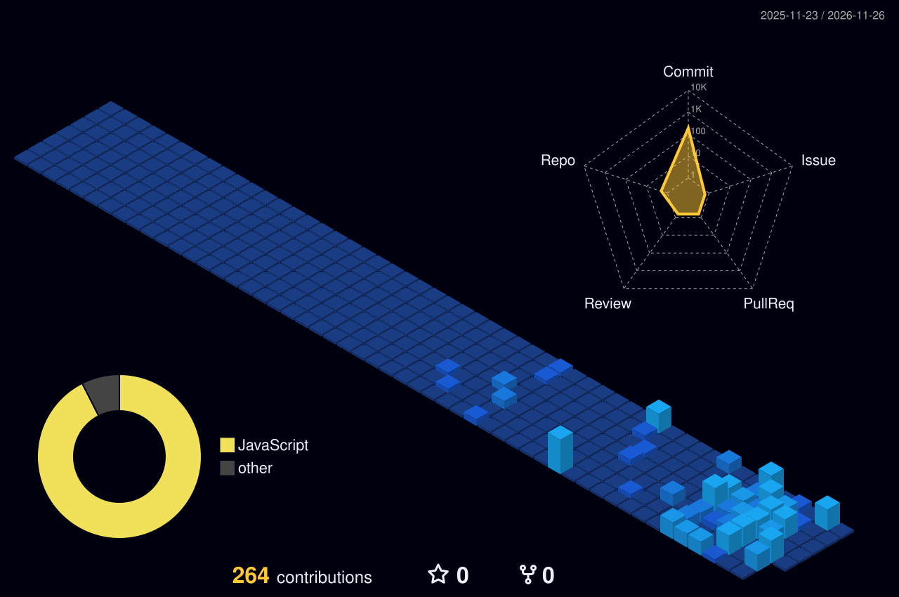

<picture>
  <source media="(prefers-color-scheme: dark)" srcset="dist/snake-dark.svg" />
  <source media="(prefers-color-scheme: light)" srcset="dist/snake.svg" />
  
</picture>

## 🤝 Let's connect

  Open to <b>full-stack web developer</b>, <b>UI/UX designer</b> and <b>design engineer</b> roles: I study the problem first, then build the solution.
    
  <a href="https://www.linkedin.com/in/mustafa-chyad"><b>💼 LinkedIn</b></a> &nbsp;·&nbsp;
  <a href="https://www.behance.net/mostafa01"><b>🎨 Behance (UI/UX &amp; design work)</b></a> &nbsp;·&nbsp;
  <a href="https://www.instagram.com/mustafabashar_/"><b>📸 Instagram</b></a> &nbsp;·&nbsp;
  <a href="https://wa.me/9647713522708"><b>📱 +964 771 352 2708</b></a> &nbsp;·&nbsp;
  <a href="https://alpha-board-app.vercel.app"><b>🌐 Alpha Board</b></a>

<picture><source media="(prefers-color-scheme: light)" srcset="assets/footer-light.svg" /><source media="(prefers-color-scheme: dark)" srcset="assets/footer.svg" /></picture>

